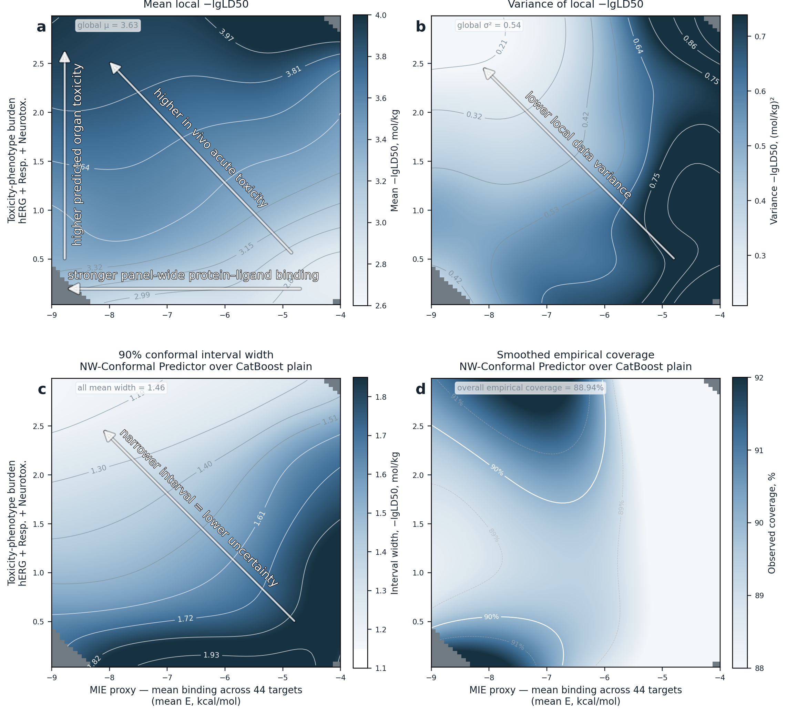

# A biology-informed uncertainty model for toxicological QSAR

This repository reproduces the final figures and tables for an acute-toxicity
quantitative structure--activity relationship (QSAR) workflow. It combines molecular fingerprints,
physicochemical descriptors, docking energies for a 44-protein safety panel,
ADMET-derived annotations, CatBoost regression, SHAP interpretation, and
localized conformal prediction intervals.

The active cohort contains **12,650 molecules**. Evaluation uses
**30 Butina cluster-disjoint splits** across **8,256 structural
clusters**. These are internal resampling checks, not external or causal
validation.

<p align="center">
  
</p>

## Project structure

```text
├── data/
│   ├── df_final.csv                       # Active processed molecular table
│   ├── df_admetlab.csv                    # Preserved ADMETLab snapshot
│   ├── admetlab_features.csv              # ADMET feature-role annotation
│   ├── excluded_molecules.csv             # Exclusion registry
│   ├── receptor_panel_annotation.csv      # 44-target panel annotation
│   └── splits/                             # Deterministic Butina split registry
├── notebooks/                              # Numbered end-to-end workflow
├── scripts/                                # Reusable training and audit code
├── results/
│   ├── figures/                            # Eight final reader-facing figures
│   └── tables/                             # Twenty-six final result tables
├── .gitignore
├── README.md
└── requirements.txt
```

Model files, calibration outputs, and prediction dumps are recreated locally in
`results/models/` when the notebooks in `notebooks/` are run in sequence. Large
trained-model files are intentionally not included in the repository because
they are reproduced when the pipeline is run.

## Inputs and models

### Input blocks

- **Structure:** 2,048-bit Morgan fingerprints.
- **Physicochemical descriptors:** molecular weight and logP.
- **Protein-interaction descriptors:** docking energies for 44 safety-relevant
  protein targets.
- **ADMET block:** numerical ADMETLab-derived descriptors and annotations.
- **Confidence coordinates:** mean docking energy plus hERG, respiratory, and
  drug-induced neurotoxicity outputs for local interval calibration.

### Model variants

| Model | Feature space |
|---|---|
| Baseline | Structure, physicochemical descriptors, and 44 docking energies |
| PCA | Structure, physicochemical descriptors, and 3 docking-panel principal components |
| ADME | Baseline plus the ADMET descriptor block |
| Plain | Structure and physicochemical descriptors only |
| BBB pass | Baseline evaluated only in the BBB-permeant subset |

All train-fitted operations use the training portion of each split only. The
held-out test portion is not used for fitting, feature selection, or interval
calibration.

## Reproduce the workflow

The workflow was tested with Python 3.14. Create the environment outside the
repository so generated dependencies remain separate from the source files.

```bash
VENV=/path/outside/the/repository/tox-repro-venv
python3 -m venv "$VENV"
"$VENV/bin/python" -m pip install --upgrade pip
"$VENV/bin/python" -m pip install -r requirements.txt

for notebook in notebooks/[0-9][0-9]_*.ipynb; do
  "$VENV/bin/jupyter" nbconvert --to notebook --execute --inplace \
    --ExecutePreprocessor.timeout=0 "$notebook"
done
```

The workflow uses supplied repository data only; it does not require a network
connection or external command-line tools.

### Notebook sequence

1. **01 — Data inventory and split registry:** validates the supplied cohort and
   deterministically reconstructs the 30 structural splits.
2. **02 — Model training:** fits the five CatBoost variants and writes recreated
   local artifacts under `results/models/`.
3. **03 — Performance figures and Table 1:** creates Figures 1--2 and the model
   comparison table.
4. **04 — SHAP interpretation:** creates Figures 3--4 plus 30-split SHAP
   stability summaries.
5. **05 — Local confidence landscape:** creates Figure 5 and its fixed-split
   summary.
6. **06 — Table validation:** validates article-facing numerical sources.
7. **07 — Additional checks:** creates reviewer and Supplementary robustness
   summaries.
8. **08 — Final source validation:** verifies the final table sources; it does
   not create an article or PDF.

## Results

### Thirty-split model comparison

Values are means across 30 held-out test sets. `90% PI` is the mean
prediction-interval width; coverage is the fraction of held-out values lying
inside the nominal 90% interval.

| Model | RMSE | MAE | R² | Spearman | CCC | 90% PI | 90% coverage |
|---|---:|---:|---:|---:|---:|---:|---:|
| Baseline | 0.522 | 0.365 | 0.490 | 0.688 | 0.660 | 1.607 | 90.13% |
| PCA | 0.515 | 0.359 | 0.504 | 0.697 | 0.670 | 1.590 | 90.21% |
| ADME | 0.510 | 0.353 | 0.513 | 0.709 | 0.667 | 1.547 | 90.18% |
| Plain | 0.511 | 0.354 | 0.511 | 0.705 | 0.670 | 1.564 | 90.17% |
| Plain (BBB subset) | 0.458 | 0.322 | 0.453 | 0.670 | 0.626 | 1.564 | 92.20% |
| BBB pass (BBB subset) | 0.466 | 0.327 | 0.433 | 0.662 | 0.608 | 1.425 | 90.01% |

The two rows marked “BBB subset” are evaluated on a filtered domain and are not
universal replacements for the full-cohort models.

### Local conformal confidence landscape

Figure 5 shows the fixed display split (`split_index=1`,
seed `43`). Its calibration set contains
**1,939 molecules** and its held-out test set contains
**2,567 molecules**. On that test set, the local 90% interval
has **88.94% coverage** and mean width
**1.456**, compared with the stored global
split-conformal width of **1.525**. The local
fallback rule was used for **1.01%**
of displayed-split test molecules.

Across all 30 splits, the biology-informed local 90% interval has mean
coverage **89.63%** and mean width
**1.497**. The corresponding global
split-conformal interval has mean coverage
**90.17%** and mean width
**1.564**. These local intervals are
descriptive confidence estimates; nominal coverage is assessed globally across
held-out molecules, not guaranteed within every local region.

## Final evidence files

| Result | Final source file(s) |
|---|---|
| Figures 1--2 and model comparison | `results/figures/fig1.png`, `results/figures/fig2.png`, `results/tables/table1_model_comparison.csv` |
| Figures 3--4 and SHAP summaries | `results/figures/fig3.png`, `results/figures/fig4a.png`, `results/figures/fig4b.png`, `results/figures/fig4c.png`, `results/tables/shap_group_importance.csv`, `results/tables/shap_top20_stability_supplementary.csv` |
| Figure 5 confidence landscape | `results/figures/fig5.png`, `results/tables/fig5_summary.csv`, `results/tables/local_conformal_width_coverage_summary.csv` |
| Supplementary confidence checks | `results/figures/local_conformal_width_coverage_curve.png`, `results/tables/tableS5B_btox_quintiles.csv`, `results/tables/tableS6_docking_coordinate.csv`, `results/tables/local_conformal_summary.csv` |
| Structural-similarity checks | `results/tables/nearest_neighbor_summary_across_splits.csv`, `results/tables/similarity_threshold_sensitivity_summary.csv` |
| Marker and collinearity checks | `results/tables/marker_summary.csv`, `results/tables/selection_frequency.csv`, `results/tables/label_isolation.csv`, `results/tables/substitution_sensitivity.csv`, `results/tables/btox_identity_by_split.csv`, `results/tables/herg10_redundancy.csv`, `results/tables/vif_summary.csv` |
| Docking-panel alignment | `results/tables/docking_panel_alignment.csv` |

## Interpretation limits

Docking energies and ADMETLab quantities are structure-dependent model-derived
descriptors, not direct experimental binding measurements. The protein panel
therefore provides biologically organized prediction and confidence features; it
does not establish causal toxicological mechanisms. The split protocol tests
robustness within one historical cohort and does not replace external,
prospective, temporal, or regulatory validation.

## License and contact

MIT License. For questions, contact safronov [dog] phystech.edu.
